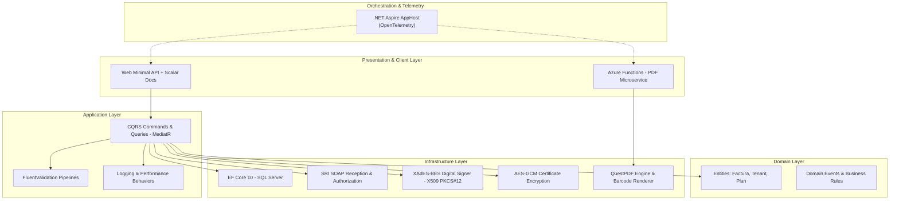

# 🏗️ Tributífico – Cloud-Native Electronic Invoicing Platform (Architecture Showcase)

> **⚠️ Repository Notice:** Tributífico is a real-world, production-ready SaaS operating with active enterprise clients. To protect intellectual property, this repository serves as an **Architecture Showcase**. It contains sanitized code snippets, architectural diagrams, and documentation demonstrating the system's design patterns, security implementations, and domain logic.

## 1. Overview & Business Case

**Tributífico** is an enterprise-grade, multi-tenant SaaS platform built with **.NET 10** for the generation, cryptographic digital signing, and official authorization of electronic tax documents. It was engineered to comply with the strict regulatory requirements of Ecuador's Internal Revenue Service (SRI), handling complex tax logic, high-throughput document issuance, and strict data isolation per tenant.

🔗 **Live Production API Documentation:** 👉 [api.tributifico.com/scalar](https://api.tributifico.com/scalar)

---

## 2. Architecture & Tech Stack

The solution implements a highly decoupled, cloud-native architecture based on **Clean Architecture** and **Domain-Driven Design (DDD)**. 

### Core Technologies
* **Framework:** .NET 10 (C# 13)
* **Design Patterns:** Clean Architecture, CQRS with MediatR, Transactional Outbox, Pipeline Behaviors.
* **Data Access:** Entity Framework Core 10 with automatic Domain Event dispatching interceptors.
* **Serverless:** Azure Functions (Isolated Worker Model).
* **Security:** AES-GCM 256-bit encryption, XAdES-BES digital signatures, multi-tenant JWT RBAC.

---

## 3. Key Engineering Challenges Solved

As the Lead Backend Architect, I focused on building a resilient, secure, and scalable system capable of handling B2B workloads. Here are the core architectural challenges solved in this project:

### 🛡️ Enterprise Cryptography & Data Protection at Rest
Handling government-issued PKCS#12 (`.p12`) digital certificates requires bank-grade security. I engineered a secure storage mechanism using authenticated symmetric encryption **(AES-GCM 256-bit)** to encrypt tenant tax passwords and certificates at rest in the database. For the document signing process, I implemented a custom **XAdES-BES** digital signature engine using `System.Security.Cryptography.Pkcs` and `Xml`, guaranteeing mathematical non-repudiation of all XML tax documents.

### ⚡ Serverless Offloading for CPU-Intensive Tasks
Generating high-fidelity PDF representations of tax documents (RIDE) with dynamic SVG barcodes is a highly CPU-intensive task. To prevent Thread Pool starvation on the main .NET 10 API, I completely decoupled the reporting engine. The main API now publishes an event, and a serverless **Azure Functions (Isolated Worker)** microservice asynchronously handles the PDF generation using QuestPDF. This decoupling improved the main API response times by maintaining a highly available HTTP pipeline.

### 🔄 HTTP Resilience Against Unstable External APIs
The government's SOAP web services (SRI) are notoriously unstable and prone to latency spikes or downtime. To guarantee system fault tolerance, I integrated `Microsoft.Extensions.Http.Resilience`, implementing robust Retry Policies, Circuit Breakers, and Timeouts. This ensures that transient failures in government servers do not cascade into the Tributífico platform, providing a seamless experience for the end user.

### 📊 Strict OpenAPI Contracts for Frontend Integration
To establish a "T-Shaped" developer workflow and eliminate frontend-backend discrepancies, I replaced legacy Swagger with **Scalar**. By enforcing strict OpenAPI specifications, the React SPA seamlessly generates strongly-typed TypeScript clients, drastically reducing integration bugs and streamlining the CI/CD pipeline.

---

## 4. Live API & Distributed Observability

To monitor the distributed nature of the CQRS API and the Azure Functions microservices, the entire platform is orchestrated via **.NET Aspire** and heavily instrumented with **OpenTelemetry**. This provides end-to-end distributed tracing, structured logging, and real-time metrics.

Check out the live, interactive API documentation running in production:  
👉 **[api.tributifico.com/scalar](https://api.tributifico.com/scalar)**
